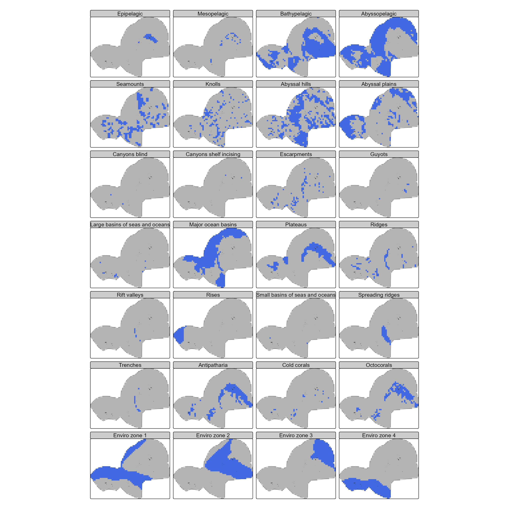
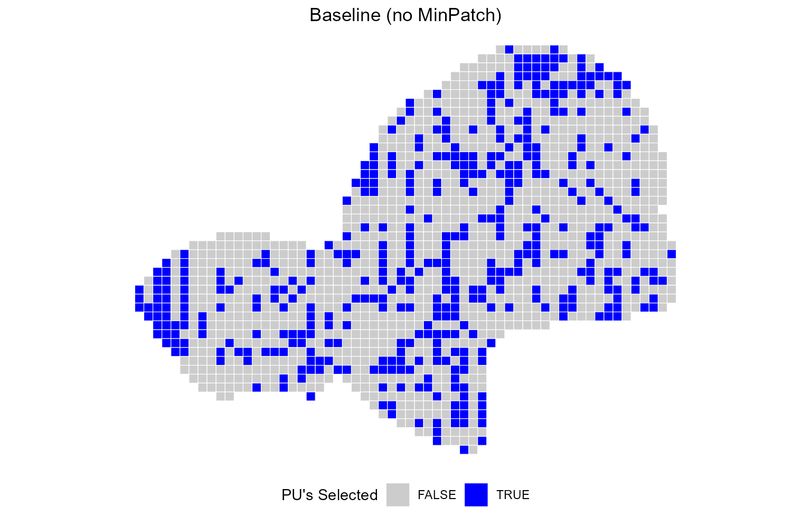
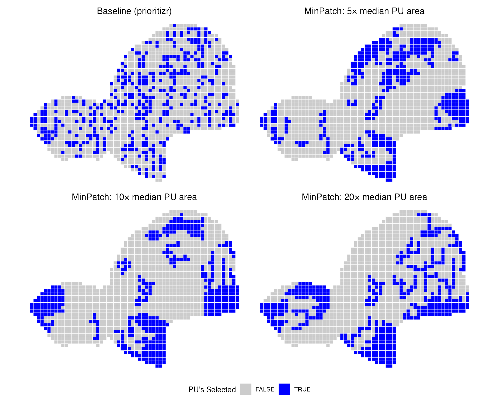
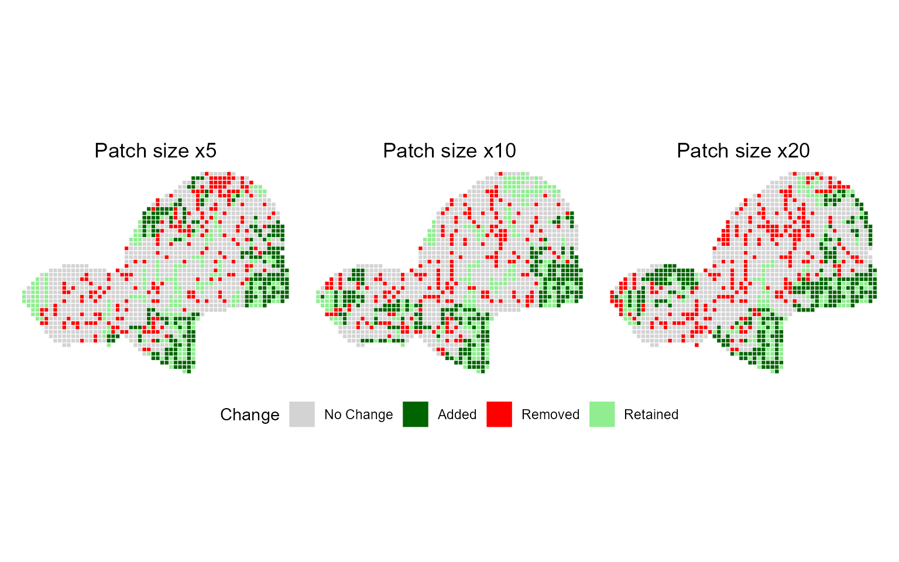
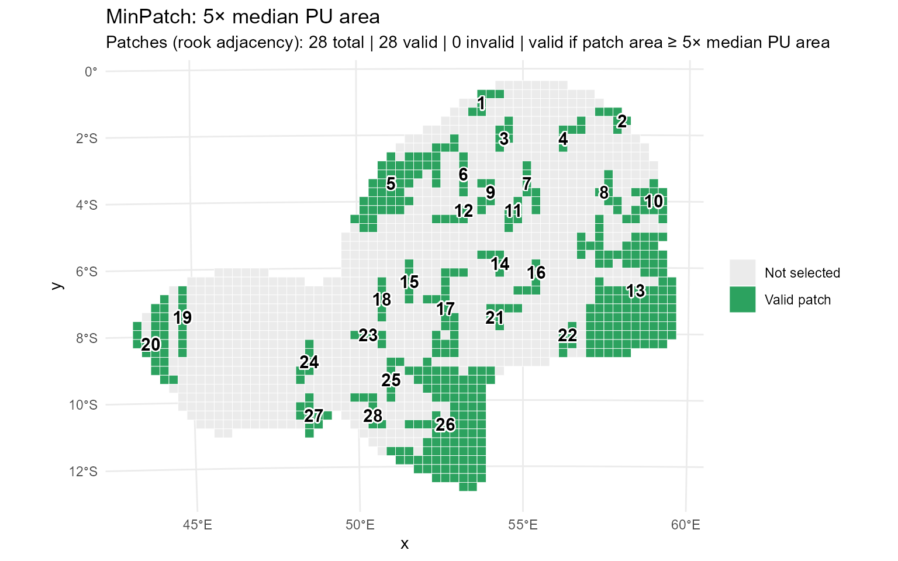
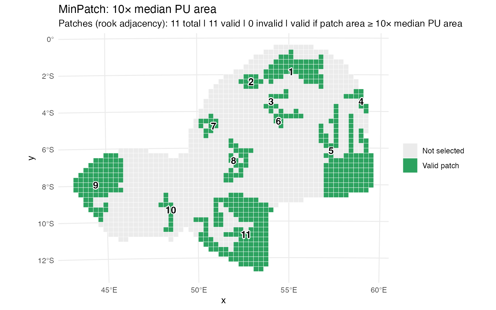
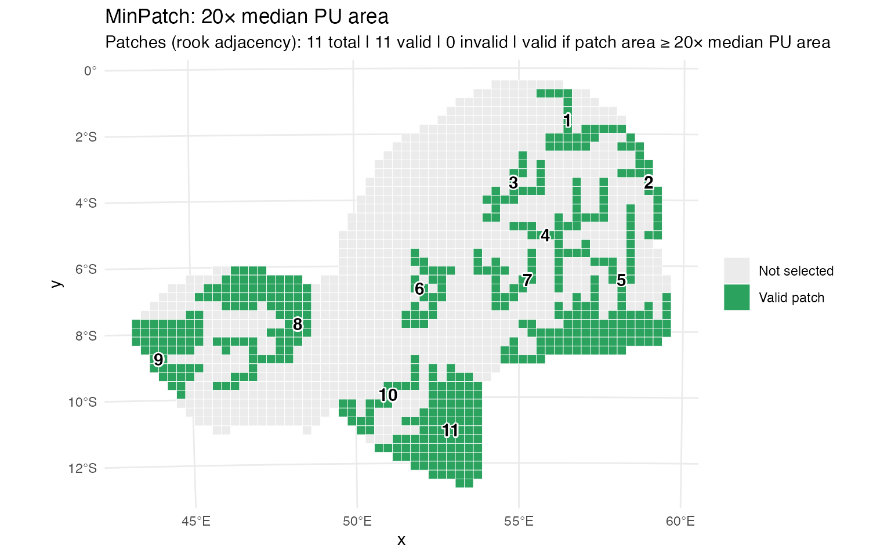
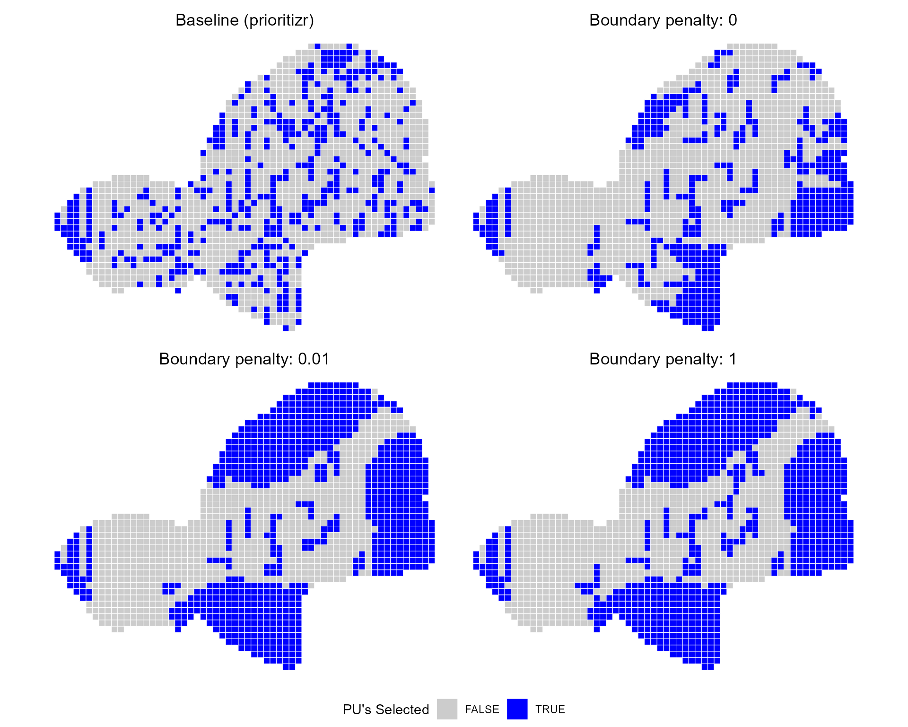
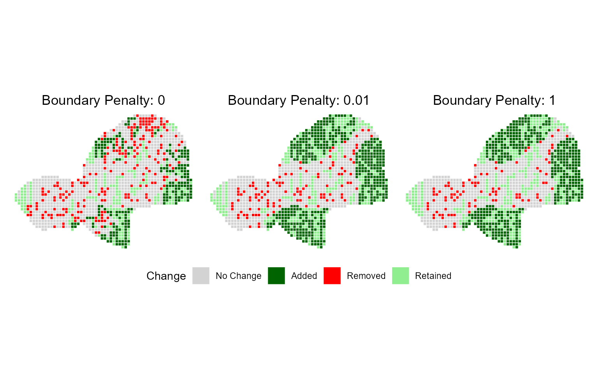

# Reducing protected area fragmentation in the Seychelles: A Case Study

## 1. Introduction

In many marine spatial planning problems, the goal is not only to meet
representation targets at the lowest possible cost, but also to consider
*how selected areas are arranged in space*. Highly fragmented marine
protected areas can be difficult to manage and enforce, and small
isolated patches may not sustain viable populations. Scattered solutions
can also be difficult to justify to decision-makers and stakeholders.

Two R packages are especially helpful for tackling these issues in a
marine context.

- The `oceandatr` package offers a practical way to build realistic,
  analysis-ready marine planning datasets. It helps users obtain
  planning boundaries (e.g., exclusive economic zones or high-seas
  regions), generate planning-unit grids, and access global ocean
  datasets—including bathymetry, geomorphology, seamounts, and
  environmental conditions—aligned to those grids. Together, these tools
  make it easier to assemble consistent inputs for marine spatial
  planning analyses.

- The `minpatch` package is a post-processing tool that modifies
  conservation planning solutions produced by `prioritizr` to reduce
  fragmentation. It enforces a user-defined minimum patch size by
  removing patches that are too small and adding new areas to maintain
  conservation targets. It then simplifies the solution by removing
  unnecessary planning units, while tracking how these changes affect
  patch structure and total cost.

In this vignette, we demonstrate the use of `oceandatr` and `minpatch`
using a simple marine example from the Seychelles Exclusive Economic
Zone. We first use `oceandatr` to construct a gridded planning problem
with a set of marine features and then solve a standard `prioritizr`
minimum-set problem. We then apply `minpatch` to explore how different
minimum patch sizes and boundary penalties influence the resulting
solutions.

## 2. Study region and planning units with oceandatr

### 2.1 Load packages

``` r
library(minpatch)
library(oceandatr)
library(terra)
library(sf)
library(dplyr)
library(ggplot2)
library(purrr)
library(stringr)
library(tibble)
library(patchwork)
library(prioritizr)
library(kableExtra)
library(tmap)
set.seed(123)

build_dir <- file.path(getwd(), "_build")
dir.create(build_dir, showWarnings = FALSE, recursive = TRUE)
```

### 2.2 Seychelles EEZ as the planning region

We start by using
[`get_boundary()`](https://emlab-ucsb.github.io/spatialgridr/reference/get_boundary.html)
from `oceandatr` to obtain the Seychelles Exclusive Economic zone (EEZ).
This defines our marine planning domain.

``` r
Seychelles_eez <- get_boundary(name = "Seychelles")

# plot to check we have Seychelles' EEZ
plot(Seychelles_eez[1], 
     col = "lightgreen", 
     main = "Seychelles EEZ", 
     axes = TRUE)
```


### 2.3 Choose an equal-area projection

We reproject the planning region into an equal-area projection to ensure
that area- and distance-based calculations are meaningful.

``` r
# use sf::st_bbox to get the bounding box coordinates (in lon/lat)
#sf::st_bbox(Seychelles_eez)

# use projectionwizard.org to choose an equal-area projection, then store as a PROJ string
# https://projectionwizard.org 

projection_Seychelles <- "+proj=laea +lon_0=55 +lat_0=-4.5 +datum=WGS84 +units=m +no_defs"

# check CRS if needed
# sf::st_crs(projection_Seychelles) 
```

### 2.4 Create a planning-unit grid

We now create a grid over the EEZ. To keep runtime moderate, we use a
fairly coarse resolution. Our units will be in meters.

``` r
# check which units to use
# sf::st_crs(projection_Seychelles, 
#           parameters = TRUE)$units_gdal

# grid the planning area
Seychelles_grid <- get_grid(
  boundary   = Seychelles_eez,
  resolution = 30000, # 30,000 just to test the code but a finer resolution can be opted with a more powerful PC    
  crs        = projection_Seychelles)

# project the eez into same projection as grid for plotting
Seychelles_eez_proj <- Seychelles_eez %>%
  sf::st_transform(crs = projection_Seychelles) %>%
  sf::st_geometry()

# plot the grid
terra::plot(Seychelles_grid, 
            col = "gold3", 
            axes = FALSE, 
            legend = FALSE,
            main = "Seychelles spatial grid (30 km)")
plot(Seychelles_eez_proj, 
     add = TRUE, 
     border = "black", 
     lwd = 1)
```


Each *cell* of `Seychelles_grid` is a planning unit. To build a
`prioritizr` problem later, it’s useful to have a vector version of the
grid:

``` r
# convert grid to sf polygons as minpatch only works with sf
Seychelles_pu <- Seychelles_grid %>%
  stars::st_as_stars() %>%
  sf::st_as_sf() %>%
  dplyr::mutate(
    id   = dplyr::row_number(),
    cost = as.numeric(sf::st_area(.)) / 1e6  # cost = area in km²
  ) %>%
  dplyr::select(-layer)
```

## 3. Building marine features with oceandatr

We will use a set of features available on `oceandatr`:

- bathymetric depth zones
- geomorphology - seafloor features (banks, ridges, etc.)
- knolls
- seamounts
- coral habitat
- environmental zones - clusters of environmental conditions

### 3.1 Prepare feature stack

These layers can easily be obtained using the `get_features` function.

``` r
# set seed for reproducibility in the get_enviro_zones() sampling to find optimal cluster number
set.seed(500)

feature_set <- get_features(spatial_grid = Seychelles_grid) %>%
  remove_empty_layers()

saveRDS(feature_set, file = file.path(build_dir, "feature_set.rds"))

# tidy up feature data names for nicer mapping
names(feature_set) <-  gsub("_", " ", names(feature_set)) %>% stringr::str_to_sentence()
```

### 3.2 Plot features

Features are visualised with **tmap**. Planning units are coloured
*blue* where a feature is present and *grey* where it is absent.

``` r
names(feature_set) <- names(feature_set) %>% 
  gsub("_", " ", .) %>% 
  stringr::str_to_sentence()

feature_bin <- feature_set > 0

m <- tm_shape(feature_bin) +
  tm_raster(
    col.scale = tm_scale_categorical(
      values = c("grey70", "royalblue"),
      labels = c("Absent", "Present")
    ),
    col.legend = tm_legend_hide(),   # hide legend for this layer
    col.free = FALSE
  ) +
  tm_facets(ncol = 4) +
  tm_shape(Seychelles_eez) +
  tm_borders() +
  tm_layout(
    panel.label.size = 1.5,
    legend.show = FALSE )

m +
  tm_add_legend(
    type = "fill",
    labels = c("Absent", "Present"),
    col = c("grey70", "royalblue"),
    title = ""
  ) +
  tm_layout(
    legend.outside = TRUE,
    legend.position = c("center", "bottom"),
    legend.text.size = 1
  )
```



### 3.3 Converting features to sf object and combining it with the PU grid

As MinPatch only works well with sf objects, we convert this feature
stack into sf. Afterwards, we put features and the grid as one data
table.

``` r
# features to sf
features <- feature_set %>%
  stars::st_as_stars() %>% # convert data to sf
  sf::st_as_sf() %>%
  dplyr::mutate(id = dplyr::row_number()) %>%
  sf::st_drop_geometry()

# combining 
Seychelles_sf <- Seychelles_pu %>%
  dplyr::left_join(
    as.data.frame(features),
    by = "id"
  )

# store feature column names
feature_set <- names(features) %>%
  dplyr::setdiff("id")
```

## 4. Build and solve a `prioritizr` problem

We now build a simple minimum-set problem using `prioritizr`, with
equal-weight features and a uniform target of 30% for each feature.

``` r
# build the problem using sf planning units + feature columns
p_base <- prioritizr::problem(
  x              = Seychelles_sf,
  features       = feature_set,
  cost_column    = "cost") %>%
  add_min_set_objective() %>%
  add_relative_targets(0.30) %>% # 30% of each feature
  add_binary_decisions() %>%
  add_rsymphony_solver(verbose = FALSE) # change this to cbc later
p_base
```

    #> A conservation problem (<ConservationProblem>)
    #> ├•data
    #> │├•features:    "Epipelagic", "Mesopelagic", "Bathypelagic", "Abyssopelagic", … (28 total)
    #> │└•planning units:
    #> │ ├•data:       <sf> (1500 total)
    #> │ ├•costs:      continuous values (between 900.2126 and 900.2126)
    #> │ ├•extent:     -1301436, -912664.9, 511794.5, 457589 (xmin, ymin, xmax, ymax)
    #> │ └•CRS:        +proj=laea +lat_0=-4.5 +lon_0=55 +x_0=0 +y_0=0 +datum=WGS84 +units=m +no_defs (projected)
    #> ├•formulation
    #> │├•objective:   minimum set objective
    #> │├•penalties:   none specified
    #> │├•features:
    #> ││├•targets:    relative targets (all equal to 0.3)
    #> ││└•weights:    none specified
    #> │├•constraints: none specified
    #> │└•decisions:   binary decision
    #> └•optimization
    #>  ├•portfolio:   default portfolio
    #>  └•solver:      rsymphony solver (`gap` = 0.1, `time_limit` = 2147483647, `first_feasible` = FALSE, …)
    #> # ℹ Use `summary(...)` to see complete formulation.

We then solve this baseline problem without any fragmentation controls
and use it as a reference for the MinPatch experiments.

``` r
# solve the baseline problem
t_base <- system.time({
  s_base <- solve(p_base)
})

# Plot the baseline solution
p_base_plot <- plot_prioritizr(s_base) +
  ggtitle("Baseline (no MinPatch)")

p_base_plot
```



In this baseline solution, we see that the selected planning units are
fragmented and scattered across the planning region.

## 5. Set up MinPatch parameters

We define minimum patch sizes relative to the planning units by scaling
the **median PU area** by `multipliers` (5×, 10×, 20×). This makes the
thresholds easy to interpret as “roughly how many planning units per
patch”. We also set a single `patch_radius` for all runs, chosen to
represent a neighbourhood of about 10 planning units. This radius
defines the spatial search distance used by MinPatch to identify
neighbouring planning units when forming, expanding, or merging patches.

``` r
# median planning-unit area (m² and km²)
median_pu_area_m2 <- median(st_area(Seychelles_sf))
median_pu_area_km2 <- median_pu_area_m2 / 1e6

# multipliers relative to the median PU area
multipliers <- c(5, 10, 20)

# minimum patch sizes in m² and km²
patch_sizes_m2  <- multipliers * median_pu_area_m2
patch_sizes_km2 <- patch_sizes_m2 / 1e6

# setting patch radius as the length of 10 PUs
median_pu_length_m <- sqrt(median_pu_area_m2)

# set radius to 10 PU lengths
patch_radius <- 10 * median_pu_length_m

# summary table
minpatch_param_summary <- tibble::tibble(
  multiplier       = multipliers,
  min_patch_m2     = patch_sizes_m2,
  min_patch_km2    = patch_sizes_km2,
  median_pu_m2     = median_pu_area_m2,
  median_pu_area_km2 = median_pu_area_km2)

# summaries of the different values
cat("\nMinPatch parameters (relative to planning units):\n")
#> 
#> MinPatch parameters (relative to planning units):

cat("- Median planning unit area:",
    round(median_pu_area_km2, 3), "km^2\n\n")
#> - Median planning unit area: 900.213 km^2

for (i in seq_along(multipliers)) {
  cat("Multiplier:", multipliers[i], "x median PU area\n")
  cat("  - Minimum patch size:",
      round(patch_sizes_km2[i], 2), "km^2\n")
  cat("  - Corresponds to ≈",
      round(patch_sizes_km2[i] / median_pu_area_km2, 2),
      "planning units\n\n")
}
#> Multiplier: 5 x median PU area
#>   - Minimum patch size: 4501.06 km^2
#>   - Corresponds to ≈ 5 planning units
#> 
#> Multiplier: 10 x median PU area
#>   - Minimum patch size: 9002.13 km^2
#>   - Corresponds to ≈ 10 planning units
#> 
#> Multiplier: 20 x median PU area
#>   - Minimum patch size: 18004.25 km^2
#>   - Corresponds to ≈ 20 planning units

median_pu_length <- sqrt(median_pu_area_m2)      # ~ PU width (m)
radius_in_pus <- patch_radius / median_pu_length # PU-widths

cat("Patch radius used for all runs:\n")
#> Patch radius used for all runs:
cat("  -", round(patch_radius, 0), "m (≈", round(patch_radius/1000, 2), "km)\n")
#>   - 300035 m (≈ 300.04 km)
cat("  - ≈", round(radius_in_pus, 1), "planning units outward (radius)\n")
#>   - ≈ 10 planning units outward (radius)
```

## 6. Run MinPatch for different minimum patch sizes

We now run MinPatch once for each minimum patch factor using the
different multipliers. Each run starts from the same `prioritizr`
solution but applies different constraints on minimum patch size.

``` r
minpatch_results <- vector("list", length(patch_sizes_m2))
minpatch_times <- numeric(length(patch_sizes_m2))

for (i in seq_along(patch_sizes_m2)) {
  
  cat("\n============================================\n")
  cat("Running MinPatch with min patch area ~",
      round(patch_sizes_km2[i], 2), "km^2 (",
      multipliers[i], "x median PU)\n")
  cat("============================================\n")
  
  # time the MinPatch run
  t_mp <- system.time({
    minpatch_results[[i]] <- run_minpatch(
      prioritizr_problem   = p_base,
      prioritizr_solution  = s_base,
      min_patch_size       = patch_sizes_m2[i],
      patch_radius         = patch_radius,
      boundary_penalty     = 0,
      remove_small_patches = TRUE,
      add_patches          = TRUE,
      whittle_patches      = TRUE,
      verbose              = TRUE
    )
    
  })
  
  # store elapsed time (seconds)
  minpatch_times[i] <- t_mp[["elapsed"]]
}
#> 
#> ============================================
#> Running MinPatch with min patch area ~ 4501.06 km^2 ( 5 x median PU)
#> ============================================
#> Validating inputs...
#> Initializing data structures...
#> Calculating boundary matrix (optimized version)...
#> Processed 1500 of 1500 planning units
#> Creating patch radius dictionary (optimized)...
#> Processed 100 of 1500 planning units
#> Processed 200 of 1500 planning units
#> Processed 300 of 1500 planning units
#> Processed 400 of 1500 planning units
#> Processed 500 of 1500 planning units
#> Processed 600 of 1500 planning units
#> Processed 700 of 1500 planning units
#> Processed 800 of 1500 planning units
#> Processed 900 of 1500 planning units
#> Processed 1000 of 1500 planning units
#> Processed 1100 of 1500 planning units
#> Processed 1200 of 1500 planning units
#> Processed 1300 of 1500 planning units
#> Processed 1400 of 1500 planning units
#> Processed 1500 of 1500 planning units
#> Calculating initial patch statistics...
#> Stage 1: Removing small patches...
#> Stage 2: Adding new patches...
#>   Initial unmet targets: 23 
#>   Unmet feature IDs: 1, 3, 4, 5, 6, 7, 8, 9, 10, 11, 12, 14, 15, 16, 17, 19, 21, 22, 24, 25, 26, 27, 28 
#>   Iteration 1 - Unmet targets: 23 
#>     Found 1227 potential patches with scores
#>     Best score: 0.0001291295 for unit 1035 
#>     Added patch centered on unit 1035 
#>   Iteration 2 - Unmet targets: 16 
#>     Found 1141 potential patches with scores
#>     Best score: 0.0001250827 for unit 1484 
#>     Added patch centered on unit 1484 
#>   Iteration 3 - Unmet targets: 8 
#>     Found 1052 potential patches with scores
#>     Best score: 0.00005247631 for unit 1 
#>     Added patch centered on unit 1 
#>   Iteration 4 - Unmet targets: 4 
#>     Found 955 potential patches with scores
#>     Best score: 0.00002426124 for unit 103 
#>     Added patch centered on unit 103 
#>   Iteration 5 - Unmet targets: 2 
#>     Found 746 potential patches with scores
#>     Best score: 0.00001657983 for unit 1464 
#>     Added patch centered on unit 1464 
#>   All conservation targets are now met!
#> Stage 3: Removing unnecessary planning units...
#>     Edge units found: 207 
#>     Keystone units: 0 
#>     New keystone units: 4 
#>     Scoreable units: 203 
#>     Removed unit 229 at iteration 1 
#>     Edge units found: 204 
#>     Keystone units: 4 
#>     New keystone units: 0 
#>     Scoreable units: 204 
#>     Removed unit 198 at iteration 2 
#>     Edge units found: 206 
#>     Keystone units: 4 
#>     New keystone units: 0 
#>     Scoreable units: 206 
#>     Removed unit 168 at iteration 3 
#>     Edge units found: 208 
#>     Keystone units: 4 
#>     New keystone units: 0 
#>     Scoreable units: 208 
#>     Removed unit 139 at iteration 4 
#>     Edge units found: 210 
#>     Keystone units: 4 
#>     New keystone units: 0 
#>     Scoreable units: 210 
#>     Removed unit 140 at iteration 5 
#>     Removed unit 113 at iteration 6 
#>     Removed unit 167 at iteration 7 
#>     Removed unit 197 at iteration 8 
#>     Removed unit 228 at iteration 9 
#>     Removed unit 383 at iteration 10 
#>   Whittling iteration 100 
#>   Whittling iteration 200 
#>   Whittling iteration 300 
#>   Whittling iteration 400 
#>   No units can be removed - all are keystone - terminating
#> Calculating final statistics...
#> MinPatch processing complete!
#> 
#> ============================================
#> Running MinPatch with min patch area ~ 9002.13 km^2 ( 10 x median PU)
#> ============================================
#> Validating inputs...
#> Initializing data structures...
#> Calculating boundary matrix (optimized version)...
#> Processed 1500 of 1500 planning units
#> Creating patch radius dictionary (optimized)...
#> Processed 100 of 1500 planning units
#> Processed 200 of 1500 planning units
#> Processed 300 of 1500 planning units
#> Processed 400 of 1500 planning units
#> Processed 500 of 1500 planning units
#> Processed 600 of 1500 planning units
#> Processed 700 of 1500 planning units
#> Processed 800 of 1500 planning units
#> Processed 900 of 1500 planning units
#> Processed 1000 of 1500 planning units
#> Processed 1100 of 1500 planning units
#> Processed 1200 of 1500 planning units
#> Processed 1300 of 1500 planning units
#> Processed 1400 of 1500 planning units
#> Processed 1500 of 1500 planning units
#> Calculating initial patch statistics...
#> Stage 1: Removing small patches...
#> Stage 2: Adding new patches...
#>   Initial unmet targets: 25 
#>   Unmet feature IDs: 1, 2, 3, 4, 5, 6, 7, 8, 9, 10, 11, 12, 13, 14, 15, 16, 17, 19, 21, 22, 24, 25, 26, 27, 28 
#>   Iteration 1 - Unmet targets: 25 
#>     Found 1306 potential patches with scores
#>     Best score: 0.0001083861 for unit 1456 
#>     Added patch centered on unit 1456 
#>   Iteration 2 - Unmet targets: 16 
#>     Found 1152 potential patches with scores
#>     Best score: 0.0000878979 for unit 1035 
#>     Added patch centered on unit 1035 
#>   Iteration 3 - Unmet targets: 10 
#>     Found 1065 potential patches with scores
#>     Best score: 0.00006552192 for unit 857 
#>     Added patch centered on unit 857 
#>   Iteration 4 - Unmet targets: 7 
#>     Found 994 potential patches with scores
#>     Best score: 0.00004788141 for unit 519 
#>     Added patch centered on unit 519 
#>   Iteration 5 - Unmet targets: 2 
#>     Found 864 potential patches with scores
#>     Best score: 0.00001882794 for unit 1435 
#>     Added patch centered on unit 1435 
#>   All conservation targets are now met!
#> Stage 3: Removing unnecessary planning units...
#>     Edge units found: 178 
#>     Keystone units: 0 
#>     New keystone units: 10 
#>     Scoreable units: 168 
#>     Removed unit 1171 at iteration 1 
#>     Edge units found: 169 
#>     Keystone units: 10 
#>     New keystone units: 0 
#>     Scoreable units: 169 
#>     Removed unit 1172 at iteration 2 
#>     Edge units found: 169 
#>     Keystone units: 10 
#>     New keystone units: 0 
#>     Scoreable units: 169 
#>     Removed unit 1215 at iteration 3 
#>     Edge units found: 170 
#>     Keystone units: 10 
#>     New keystone units: 0 
#>     Scoreable units: 170 
#>     Removed unit 1217 at iteration 4 
#>     Edge units found: 170 
#>     Keystone units: 10 
#>     New keystone units: 0 
#>     Scoreable units: 170 
#>     Removed unit 1253 at iteration 5 
#>     Removed unit 1289 at iteration 6 
#>     Removed unit 1290 at iteration 7 
#>     Removed unit 1291 at iteration 8 
#>     Removed unit 1292 at iteration 9 
#>     Removed unit 1199 at iteration 10 
#>   Whittling iteration 100 
#>   Whittling iteration 200 
#>   Whittling iteration 300 
#>   No units can be removed - all are keystone - terminating
#> Calculating final statistics...
#> MinPatch processing complete!
#> 
#> ============================================
#> Running MinPatch with min patch area ~ 18004.25 km^2 ( 20 x median PU)
#> ============================================
#> Validating inputs...
#> Initializing data structures...
#> Calculating boundary matrix (optimized version)...
#> Processed 1500 of 1500 planning units
#> Creating patch radius dictionary (optimized)...
#> Processed 100 of 1500 planning units
#> Processed 200 of 1500 planning units
#> Processed 300 of 1500 planning units
#> Processed 400 of 1500 planning units
#> Processed 500 of 1500 planning units
#> Processed 600 of 1500 planning units
#> Processed 700 of 1500 planning units
#> Processed 800 of 1500 planning units
#> Processed 900 of 1500 planning units
#> Processed 1000 of 1500 planning units
#> Processed 1100 of 1500 planning units
#> Processed 1200 of 1500 planning units
#> Processed 1300 of 1500 planning units
#> Processed 1400 of 1500 planning units
#> Processed 1500 of 1500 planning units
#> Calculating initial patch statistics...
#> Stage 1: Removing small patches...
#> Stage 2: Adding new patches...
#>   Initial unmet targets: 26 
#>   Unmet feature IDs: 1, 2, 3, 4, 5, 6, 7, 8, 9, 10, 11, 12, 13, 14, 15, 16, 17, 19, 21, 22, 23, 24, 25, 26, 27, 28 
#>   Iteration 1 - Unmet targets: 26 
#>     Found 1398 potential patches with scores
#>     Best score: 0.00009160525 for unit 1456 
#>     Added patch centered on unit 1456 
#>   Iteration 2 - Unmet targets: 18 
#>     Found 1218 potential patches with scores
#>     Best score: 0.00006776194 for unit 684 
#>     Added patch centered on unit 684 
#>   Iteration 3 - Unmet targets: 7 
#>     Found 1055 potential patches with scores
#>     Best score: 0.00005717078 for unit 857 
#>     Added patch centered on unit 857 
#>   Iteration 4 - Unmet targets: 4 
#>     Found 984 potential patches with scores
#>     Best score: 0.00002360005 for unit 1086 
#>     Added patch centered on unit 1086 
#>   Iteration 5 - Unmet targets: 2 
#>     Found 886 potential patches with scores
#>     Best score: 0.00001501147 for unit 593 
#>     Added patch centered on unit 593 
#>   All conservation targets are now met!
#> Stage 3: Removing unnecessary planning units...
#>     Edge units found: 108 
#>     Keystone units: 0 
#>     New keystone units: 6 
#>     Scoreable units: 102 
#>     Removed unit 173 at iteration 1 
#>     Edge units found: 102 
#>     Keystone units: 6 
#>     New keystone units: 0 
#>     Scoreable units: 102 
#>     Removed unit 174 at iteration 2 
#>     Edge units found: 103 
#>     Keystone units: 6 
#>     New keystone units: 0 
#>     Scoreable units: 103 
#>     Removed unit 175 at iteration 3 
#>     Edge units found: 105 
#>     Keystone units: 6 
#>     New keystone units: 0 
#>     Scoreable units: 105 
#>     Removed unit 176 at iteration 4 
#>     Edge units found: 107 
#>     Keystone units: 6 
#>     New keystone units: 0 
#>     Scoreable units: 107 
#>     Removed unit 177 at iteration 5 
#>     Removed unit 178 at iteration 6 
#>     Removed unit 149 at iteration 7 
#>     Removed unit 150 at iteration 8 
#>     Removed unit 123 at iteration 9 
#>     Removed unit 124 at iteration 10 
#>   Whittling iteration 100 
#>   Whittling iteration 200 
#>   Whittling iteration 300 
#>   Whittling iteration 400 
#>   No units can be removed - all are keystone - terminating
#> Calculating final statistics...
#> MinPatch processing complete!

# name the outputs
names(minpatch_results) <- paste0("minpatch_", multipliers, "x")
names(minpatch_times)   <- paste0("minpatch_", multipliers, "x")

saveRDS(minpatch_results, file = file.path(build_dir, "minpatch_results.rds"))
saveRDS(minpatch_times, file = file.path(build_dir, "minpatch_times.rds"))
```

## 7. Interpreting MinPatch outcomes

In this section, we interpret how MinPatch modifies the baseline
solution. We compare resulting spatial patterns, patch structure, and
trade-offs between fragmentation and cost.

### 7.1 Selected planning units (baseline vs MinPatch runs)

We start by showing the selected planning units for the baseline and
each MinPatch run.

``` r
patchwork::wrap_plots(
  plot_prioritizr(s_base, col = "solution_1", title = "Baseline (prioritizr)"),
  plot_prioritizr(minpatch_results[[1]]$solution, col = "minpatch",
                  title = paste0("MinPatch: ", multipliers[1], "× median PU area")),
  plot_prioritizr(minpatch_results[[2]]$solution, col = "minpatch",
                  title = paste0("MinPatch: ", multipliers[2], "× median PU area")),
  plot_prioritizr(minpatch_results[[3]]$solution, col = "minpatch",
                  title = paste0("MinPatch: ", multipliers[3], "× median PU area")),
  guides = "collect",
  ncol = 2
) &
  theme(legend.position = "bottom")
```



On the plot, we can see that the baseline solution is highly fragmented,
with many small and isolated selected planning units. As the minimum
patch size increases, these small patches are removed or merged, leading
to fewer, larger, and more spatially coherent patches.

### 7.2 Group summary table (all runs)

Having examined the spatial solutions, we summarise all runs in a single
table to compare outcomes across different metrics.

| scenario | Multiplier | Minimum patch size (km²) | Selected PUs | Total area (km²) | Total perimeter (km) | \# patches | Valid patches (\>= min size) | Median patch size (km²) | Total PU cost | Boundary cost | Overall cost | Runtime (s) |
|:---|:---|:---|:---|:---|:---|:---|:---|:---|:---|:---|:---|:---|
| Baseline | NA | NA | 452 | 406896.1 | 32136.10 | 129 | 21 | 900.21 | 406896.1 | 0 | 406896.1 | 0.9 |
| MinPatch ×5 | 5 | 4501.06 | 452 | 406896.1 | 18403.20 | 28 | 28 | 5401.28 | 406896.1 | 0 | 406896.1 | 768.8 |
| MinPatch ×10 | 10 | 9002.13 | 476 | 428501.2 | 16438.91 | 15 | 15 | 9902.34 | 428501.2 | 0 | 428501.2 | 706.5 |
| MinPatch ×20 | 20 | 18004.25 | 465 | 418598.8 | 14642.11 | 8 | 8 | 32857.76 | 418598.8 | 0 | 418598.8 | 767.5 |

Once MinPatch is applied, the solution becomes less fragmented: as the
multiplier increases, the number of patches decreases and the remaining
patches become larger (higher median patch size).

### 7.3 Change maps (Added / Removed / Retained / No change)

After comparing runs, we use `plot_minpatch` to map which planning units
were added, removed, or kept versus the baseline. The maps show how
MinPatch reshapes the solution to meet minimum patch sizes and cut
fragmentation.

``` r
# Create plots for each minpatch run and arrange them with patchwork
plot_list <- purrr::map2(
  minpatch_results,
  multipliers,
  ~ plot_minpatch(
    .x,
    title = paste0("Patch size x", .y)
  )
)
patchwork::wrap_plots(
  plotlist = plot_list,
  guides   = "collect",
  ncol     = 3
) &
  theme(legend.position = "bottom")
```



### 7.4 Patch-labelled maps

We use a function that labels patches in the MinPatch solutions and
flags each one as valid (meets the minimum patch-size rule) or invalid
(below the threshold; if they exist). This makes the patch definition
explicit and helps interpret the patch counts in the summary table.

Patch counts depend on how “connected” is defined. MinPatch uses
**rook** **adjacency**, where planning units must share an edge to be in
the same patch. By contrast, queen adjacency also treats corner-touching
(diagonal) units as connected. For ecology and management,
rook-connected patches are often more defensible because they represent
truly contiguous area, avoid corner-only links, and tend to form more
compact patch units.

``` r
for (m in c(5, 10, 20)) {
  print(minpatch::plot_patch_validity(
    multiplier = m,
    multipliers = multipliers,
    minpatch_results = minpatch_results,
    pu_sf = Seychelles_sf,
    do_snap = FALSE
  ))
}
#> MinPatch 5x: 28 patches | 28 valid | 0 invalid (threshold = 4501.063 km²) | snap = FALSE
```



    #> MinPatch 10x: 15 patches | 15 valid | 0 invalid (threshold = 9002.126 km²) | snap = FALSE



    #> MinPatch 20x: 8 patches | 8 valid | 0 invalid (threshold = 18004.25 km²) | snap = FALSE



### 7.5 Individual summaries (per run)

Here, we show all the individual summaries for all the runs. These
provide a detailed breakdown and comparison of the metrics of each
minimum patch run with the baseline solution, as well as other
information such as feature level area comparison and feature change
summaries.

``` r
for (i in seq_along(minpatch_results)) {
  
  result <- minpatch_results[[i]]
  factor_val <- multipliers[i]
  
  cat("\n\n## Scenario: MinPatch with min patch size = ",
      factor_val, " × median PU area\n\n", sep = "")
  
  # MinPatch summary (if it prints text)
  cat("**MinPatch processing summary**\n\n")
  print_minpatch_summary(result)
  
  comparison <- compare_solutions(result)
  
  cat("\n**Overall solution comparison**\n\n")
  print(comparison$overall)
  
  cat("\n**Feature-level area comparison**\n\n")
  print(comparison$features)
  
  cat("\n**Feature change summary**\n\n")
  print(comparison$summary)
}
#> 
#> 
#> ## Scenario: MinPatch with min patch size = 5 × median PU area
#> 
#> **MinPatch processing summary**
#> 
#> === MinPatch Processing Summary ===
#> 
#> Patch Statistics:
#>   Initial patches: 129 (valid: 21)
#>   Final patches: 28 (valid: 28)
#>   Area change: 0.00 (0.0%)
#> 
#> Cost Breakdown:
#>   Planning unit cost: 406896.09
#>   Boundary cost: 0.00
#>   Total cost: 406896.09
#>   Selected units: 452
#> 
#> Feature Representation:
#>   Total features: 28
#>   Targets met: 28
#>   Targets unmet: 0
#>   Mean proportion: 0.395
#>   Total shortfall: 0.00
#> 
#> 
#> === End Summary ===
#> 
#> **Overall solution comparison**
#> 
#>                        Metric       Original       MinPatch     Change
#> 1     Selected Planning Units          452.0          452.0          0
#> 2                  Total Area 406896087807.6 406896087807.6          0
#> 3           Number of Patches          129.0           28.0       -101
#> 4 Valid Patches (>= min size)           21.0           28.0          7
#> 5           Median Patch Size    900212583.6   5401275501.9 4501062918
#> 6          Planning Unit Cost       406896.1       406896.1          0
#> 7               Boundary Cost            0.0            0.0          0
#> 8                  Total Cost       406896.1       406896.1          0
#>   Percent_Change
#> 1        0.00000
#> 2        0.00000
#> 3      -78.29457
#> 4       33.33333
#> 5      500.00000
#> 6        0.00000
#> 7             NA
#> 8        0.00000
#> 
#> **Feature-level area comparison**
#> 
#>    Feature_ID Target Original_Area MinPatch_Area Area_Change Percent_Change
#> 1           1   10.8            11            11           0      0.0000000
#> 2           2    7.2             8             8           0      0.0000000
#> 3           3  180.3           181           181           0      0.0000000
#> 4           4  251.7           252           252           0      0.0000000
#> 5           5   86.1           112            89         -23    -20.5357143
#> 6           6   45.9            46            52           6     13.0434783
#> 7           7  163.2           167           178          11      6.5868263
#> 8           8  116.1           122           120          -2     -1.6393443
#> 9           9    0.6             1             1           0      0.0000000
#> 10         10    0.6             1             2           1    100.0000000
#> 11         11   23.1            34            27          -7    -20.5882353
#> 12         12    2.1             5             4          -1    -20.0000000
#> 13         13    3.3             7             7           0      0.0000000
#> 14         14  158.7           178           159         -19    -10.6741573
#> 15         15   64.5            66            69           3      4.5454545
#> 16         16   20.7            28            27          -1     -3.5714286
#> 17         17    2.1             3             3           0      0.0000000
#> 18         18   22.5            41            32          -9    -21.9512195
#> 19         19    0.6             1             1           0      0.0000000
#> 20         20   14.4            22            25           3     13.6363636
#> 21         21    3.9             5             4          -1    -20.0000000
#> 22         22   63.9            72            80           8     11.1111111
#> 23         23    6.3             9             8          -1    -11.1111111
#> 24         24   51.3            52            54           2      3.8461538
#> 25         25  137.7           139           138          -1     -0.7194245
#> 26         26  150.0           150           150           0      0.0000000
#> 27         27   74.4            75            75           0      0.0000000
#> 28         28   87.9            88            89           1      1.1363636
#>    Original_Target_Met MinPatch_Target_Met Original_Proportion
#> 1                 TRUE                TRUE            1.018519
#> 2                 TRUE                TRUE            1.111111
#> 3                 TRUE                TRUE            1.003882
#> 4                 TRUE                TRUE            1.001192
#> 5                 TRUE                TRUE            1.300813
#> 6                 TRUE                TRUE            1.002179
#> 7                 TRUE                TRUE            1.023284
#> 8                 TRUE                TRUE            1.050818
#> 9                 TRUE                TRUE            1.666667
#> 10                TRUE                TRUE            1.666667
#> 11                TRUE                TRUE            1.471861
#> 12                TRUE                TRUE            2.380952
#> 13                TRUE                TRUE            2.121212
#> 14                TRUE                TRUE            1.121613
#> 15                TRUE                TRUE            1.023256
#> 16                TRUE                TRUE            1.352657
#> 17                TRUE                TRUE            1.428571
#> 18                TRUE                TRUE            1.822222
#> 19                TRUE                TRUE            1.666667
#> 20                TRUE                TRUE            1.527778
#> 21                TRUE                TRUE            1.282051
#> 22                TRUE                TRUE            1.126761
#> 23                TRUE                TRUE            1.428571
#> 24                TRUE                TRUE            1.013645
#> 25                TRUE                TRUE            1.009441
#> 26                TRUE                TRUE            1.000000
#> 27                TRUE                TRUE            1.008065
#> 28                TRUE                TRUE            1.001138
#>    MinPatch_Proportion
#> 1             1.018519
#> 2             1.111111
#> 3             1.003882
#> 4             1.001192
#> 5             1.033682
#> 6             1.132898
#> 7             1.090686
#> 8             1.033592
#> 9             1.666667
#> 10            3.333333
#> 11            1.168831
#> 12            1.904762
#> 13            2.121212
#> 14            1.001890
#> 15            1.069767
#> 16            1.304348
#> 17            1.428571
#> 18            1.422222
#> 19            1.666667
#> 20            1.736111
#> 21            1.025641
#> 22            1.251956
#> 23            1.269841
#> 24            1.052632
#> 25            1.002179
#> 26            1.000000
#> 27            1.008065
#> 28            1.012514
#> 
#> **Feature change summary**
#> 
#>   features_improved features_reduced features_unchanged targets_gained
#> 1                 8               10                 10              0
#>   targets_lost
#> 1            0
#> 
#> 
#> ## Scenario: MinPatch with min patch size = 10 × median PU area
#> 
#> **MinPatch processing summary**
#> 
#> === MinPatch Processing Summary ===
#> 
#> Patch Statistics:
#>   Initial patches: 129 (valid: 10)
#>   Final patches: 15 (valid: 15)
#>   Area change: 21605102007.48 (5.3%)
#> 
#> Cost Breakdown:
#>   Planning unit cost: 428501.19
#>   Boundary cost: 0.00
#>   Total cost: 428501.19
#>   Selected units: 476
#> 
#> Feature Representation:
#>   Total features: 28
#>   Targets met: 28
#>   Targets unmet: 0
#>   Mean proportion: 0.409
#>   Total shortfall: 0.00
#> 
#> 
#> === End Summary ===
#> 
#> **Overall solution comparison**
#> 
#>                        Metric       Original       MinPatch      Change
#> 1     Selected Planning Units          452.0          476.0          24
#> 2                  Total Area 406896087807.6 428501189815.1 21605102007
#> 3           Number of Patches          129.0           15.0        -114
#> 4 Valid Patches (>= min size)           10.0           15.0           5
#> 5           Median Patch Size    900212583.6   9902338420.1  9002125836
#> 6          Planning Unit Cost       428501.2       428501.2           0
#> 7               Boundary Cost            0.0            0.0           0
#> 8                  Total Cost       428501.2       428501.2           0
#>   Percent_Change
#> 1       5.309735
#> 2       5.309735
#> 3     -88.372093
#> 4      50.000000
#> 5    1000.000000
#> 6       0.000000
#> 7             NA
#> 8       0.000000
#> 
#> **Feature-level area comparison**
#> 
#>    Feature_ID Target Original_Area MinPatch_Area Area_Change Percent_Change
#> 1           1   10.8            11            11           0      0.0000000
#> 2           2    7.2             8             9           1     12.5000000
#> 3           3  180.3           181           203          22     12.1546961
#> 4           4  251.7           252           253           1      0.3968254
#> 5           5   86.1           112           100         -12    -10.7142857
#> 6           6   45.9            46            52           6     13.0434783
#> 7           7  163.2           167           172           5      2.9940120
#> 8           8  116.1           122           127           5      4.0983607
#> 9           9    0.6             1             1           0      0.0000000
#> 10         10    0.6             1             1           0      0.0000000
#> 11         11   23.1            34            29          -5    -14.7058824
#> 12         12    2.1             5             5           0      0.0000000
#> 13         13    3.3             7             4          -3    -42.8571429
#> 14         14  158.7           178           159         -19    -10.6741573
#> 15         15   64.5            66            84          18     27.2727273
#> 16         16   20.7            28            26          -2     -7.1428571
#> 17         17    2.1             3             3           0      0.0000000
#> 18         18   22.5            41            42           1      2.4390244
#> 19         19    0.6             1             1           0      0.0000000
#> 20         20   14.4            22            27           5     22.7272727
#> 21         21    3.9             5             7           2     40.0000000
#> 22         22   63.9            72            95          23     31.9444444
#> 23         23    6.3             9            11           2     22.2222222
#> 24         24   51.3            52            72          20     38.4615385
#> 25         25  137.7           139           138          -1     -0.7194245
#> 26         26  150.0           150           150           0      0.0000000
#> 27         27   74.4            75            75           0      0.0000000
#> 28         28   87.9            88           113          25     28.4090909
#>    Original_Target_Met MinPatch_Target_Met Original_Proportion
#> 1                 TRUE                TRUE            1.018519
#> 2                 TRUE                TRUE            1.111111
#> 3                 TRUE                TRUE            1.003882
#> 4                 TRUE                TRUE            1.001192
#> 5                 TRUE                TRUE            1.300813
#> 6                 TRUE                TRUE            1.002179
#> 7                 TRUE                TRUE            1.023284
#> 8                 TRUE                TRUE            1.050818
#> 9                 TRUE                TRUE            1.666667
#> 10                TRUE                TRUE            1.666667
#> 11                TRUE                TRUE            1.471861
#> 12                TRUE                TRUE            2.380952
#> 13                TRUE                TRUE            2.121212
#> 14                TRUE                TRUE            1.121613
#> 15                TRUE                TRUE            1.023256
#> 16                TRUE                TRUE            1.352657
#> 17                TRUE                TRUE            1.428571
#> 18                TRUE                TRUE            1.822222
#> 19                TRUE                TRUE            1.666667
#> 20                TRUE                TRUE            1.527778
#> 21                TRUE                TRUE            1.282051
#> 22                TRUE                TRUE            1.126761
#> 23                TRUE                TRUE            1.428571
#> 24                TRUE                TRUE            1.013645
#> 25                TRUE                TRUE            1.009441
#> 26                TRUE                TRUE            1.000000
#> 27                TRUE                TRUE            1.008065
#> 28                TRUE                TRUE            1.001138
#>    MinPatch_Proportion
#> 1             1.018519
#> 2             1.250000
#> 3             1.125901
#> 4             1.005165
#> 5             1.161440
#> 6             1.132898
#> 7             1.053922
#> 8             1.093885
#> 9             1.666667
#> 10            1.666667
#> 11            1.255411
#> 12            2.380952
#> 13            1.212121
#> 14            1.001890
#> 15            1.302326
#> 16            1.256039
#> 17            1.428571
#> 18            1.866667
#> 19            1.666667
#> 20            1.875000
#> 21            1.794872
#> 22            1.486698
#> 23            1.746032
#> 24            1.403509
#> 25            1.002179
#> 26            1.000000
#> 27            1.008065
#> 28            1.285552
#> 
#> **Feature change summary**
#> 
#>   features_improved features_reduced features_unchanged targets_gained
#> 1                14                6                  8              0
#>   targets_lost
#> 1            0
#> 
#> 
#> ## Scenario: MinPatch with min patch size = 20 × median PU area
#> 
#> **MinPatch processing summary**
#> 
#> === MinPatch Processing Summary ===
#> 
#> Patch Statistics:
#>   Initial patches: 129 (valid: 3)
#>   Final patches: 8 (valid: 8)
#>   Area change: 11702763587.39 (2.9%)
#> 
#> Cost Breakdown:
#>   Planning unit cost: 418598.85
#>   Boundary cost: 0.00
#>   Total cost: 418598.85
#>   Selected units: 465
#> 
#> Feature Representation:
#>   Total features: 28
#>   Targets met: 28
#>   Targets unmet: 0
#>   Mean proportion: 0.408
#>   Total shortfall: 0.00
#> 
#> 
#> === End Summary ===
#> 
#> **Overall solution comparison**
#> 
#>                        Metric       Original       MinPatch      Change
#> 1     Selected Planning Units          452.0          465.0          13
#> 2                  Total Area 406896087807.6 418598851395.0 11702763587
#> 3           Number of Patches          129.0            8.0        -121
#> 4 Valid Patches (>= min size)            3.0            8.0           5
#> 5           Median Patch Size    900212583.6  32857759303.0 31957546719
#> 6          Planning Unit Cost       418598.9       418598.9           0
#> 7               Boundary Cost            0.0            0.0           0
#> 8                  Total Cost       418598.9       418598.9           0
#>   Percent_Change
#> 1       2.876106
#> 2       2.876106
#> 3     -93.798450
#> 4     166.666667
#> 5    3550.000000
#> 6       0.000000
#> 7             NA
#> 8       0.000000
#> 
#> **Feature-level area comparison**
#> 
#>    Feature_ID Target Original_Area MinPatch_Area Area_Change Percent_Change
#> 1           1   10.8            11            11           0       0.000000
#> 2           2    7.2             8             8           0       0.000000
#> 3           3  180.3           181           194          13       7.182320
#> 4           4  251.7           252           252           0       0.000000
#> 5           5   86.1           112            92         -20     -17.857143
#> 6           6   45.9            46            56          10      21.739130
#> 7           7  163.2           167           173           6       3.592814
#> 8           8  116.1           122           122           0       0.000000
#> 9           9    0.6             1             1           0       0.000000
#> 10         10    0.6             1             1           0       0.000000
#> 11         11   23.1            34            27          -7     -20.588235
#> 12         12    2.1             5             5           0       0.000000
#> 13         13    3.3             7             4          -3     -42.857143
#> 14         14  158.7           178           159         -19     -10.674157
#> 15         15   64.5            66            69           3       4.545455
#> 16         16   20.7            28            34           6      21.428571
#> 17         17    2.1             3             3           0       0.000000
#> 18         18   22.5            41            34          -7     -17.073171
#> 19         19    0.6             1             2           1     100.000000
#> 20         20   14.4            22            27           5      22.727273
#> 21         21    3.9             5             6           1      20.000000
#> 22         22   63.9            72            78           6       8.333333
#> 23         23    6.3             9             9           0       0.000000
#> 24         24   51.3            52            58           6      11.538462
#> 25         25  137.7           139           142           3       2.158273
#> 26         26  150.0           150           150           0       0.000000
#> 27         27   74.4            75            75           0       0.000000
#> 28         28   87.9            88            98          10      11.363636
#>    Original_Target_Met MinPatch_Target_Met Original_Proportion
#> 1                 TRUE                TRUE            1.018519
#> 2                 TRUE                TRUE            1.111111
#> 3                 TRUE                TRUE            1.003882
#> 4                 TRUE                TRUE            1.001192
#> 5                 TRUE                TRUE            1.300813
#> 6                 TRUE                TRUE            1.002179
#> 7                 TRUE                TRUE            1.023284
#> 8                 TRUE                TRUE            1.050818
#> 9                 TRUE                TRUE            1.666667
#> 10                TRUE                TRUE            1.666667
#> 11                TRUE                TRUE            1.471861
#> 12                TRUE                TRUE            2.380952
#> 13                TRUE                TRUE            2.121212
#> 14                TRUE                TRUE            1.121613
#> 15                TRUE                TRUE            1.023256
#> 16                TRUE                TRUE            1.352657
#> 17                TRUE                TRUE            1.428571
#> 18                TRUE                TRUE            1.822222
#> 19                TRUE                TRUE            1.666667
#> 20                TRUE                TRUE            1.527778
#> 21                TRUE                TRUE            1.282051
#> 22                TRUE                TRUE            1.126761
#> 23                TRUE                TRUE            1.428571
#> 24                TRUE                TRUE            1.013645
#> 25                TRUE                TRUE            1.009441
#> 26                TRUE                TRUE            1.000000
#> 27                TRUE                TRUE            1.008065
#> 28                TRUE                TRUE            1.001138
#>    MinPatch_Proportion
#> 1             1.018519
#> 2             1.111111
#> 3             1.075984
#> 4             1.001192
#> 5             1.068525
#> 6             1.220044
#> 7             1.060049
#> 8             1.050818
#> 9             1.666667
#> 10            1.666667
#> 11            1.168831
#> 12            2.380952
#> 13            1.212121
#> 14            1.001890
#> 15            1.069767
#> 16            1.642512
#> 17            1.428571
#> 18            1.511111
#> 19            3.333333
#> 20            1.875000
#> 21            1.538462
#> 22            1.220657
#> 23            1.428571
#> 24            1.130604
#> 25            1.031227
#> 26            1.000000
#> 27            1.008065
#> 28            1.114903
#> 
#> **Feature change summary**
#> 
#>   features_improved features_reduced features_unchanged targets_gained
#> 1                12                5                 11              0
#>   targets_lost
#> 1            0
```

## 8. Run different boundary penalties

The boundary penalty controls how strongly MinPatch favours spatially
compact patches during the whittling stage. At this step, MinPatch
attempts to remove planning units from the edges of patches while
maintaining conservation targets. Whether a unit can be removed depends
on the trade-off between its planning-unit cost and the change in
boundary cost that would result from its removal.

The boundary penalty scales this trade-off by assigning a cost to
fragmentation: higher values discourage the creation of additional patch
edges and therefore promote more compact solutions. In the Seychelles
example, we explore a small range of boundary penalties to illustrate
how sensitive the whittling process is to boundary costs under a marine
grid with relatively uniform planning-unit areas.

``` r
# calculate reasonable parameters based on planning unit characteristics
median_pu_area_m2 <- median(st_area(Seychelles_sf)) 

# use minpatch size 5x median PU
# retain the same patch radius earlier
min_patch_size <- median_pu_area_m2 * 5
patch_radius
#> 300035.4 [m]

bp3 = 0
t3 <- system.time({
  result3 <- run_minpatch(
    prioritizr_problem = p_base,
    prioritizr_solution = s_base,
    min_patch_size = min_patch_size,
    patch_radius = patch_radius,
    boundary_penalty = bp3,
    remove_small_patches = TRUE,
    add_patches = TRUE,
    whittle_patches = TRUE,
    verbose = TRUE
  ) 
})
#> Validating inputs...
#> Initializing data structures...
#> Calculating boundary matrix (optimized version)...
#> Processed 1500 of 1500 planning units
#> Creating patch radius dictionary (optimized)...
#> Processed 100 of 1500 planning units
#> Processed 200 of 1500 planning units
#> Processed 300 of 1500 planning units
#> Processed 400 of 1500 planning units
#> Processed 500 of 1500 planning units
#> Processed 600 of 1500 planning units
#> Processed 700 of 1500 planning units
#> Processed 800 of 1500 planning units
#> Processed 900 of 1500 planning units
#> Processed 1000 of 1500 planning units
#> Processed 1100 of 1500 planning units
#> Processed 1200 of 1500 planning units
#> Processed 1300 of 1500 planning units
#> Processed 1400 of 1500 planning units
#> Processed 1500 of 1500 planning units
#> Calculating initial patch statistics...
#> Stage 1: Removing small patches...
#> Stage 2: Adding new patches...
#>   Initial unmet targets: 23 
#>   Unmet feature IDs: 1, 3, 4, 5, 6, 7, 8, 9, 10, 11, 12, 14, 15, 16, 17, 19, 21, 22, 24, 25, 26, 27, 28 
#>   Iteration 1 - Unmet targets: 23 
#>     Found 1227 potential patches with scores
#>     Best score: 0.0001291295 for unit 1035 
#>     Added patch centered on unit 1035 
#>   Iteration 2 - Unmet targets: 16 
#>     Found 1141 potential patches with scores
#>     Best score: 0.0001250827 for unit 1484 
#>     Added patch centered on unit 1484 
#>   Iteration 3 - Unmet targets: 8 
#>     Found 1052 potential patches with scores
#>     Best score: 0.00005247631 for unit 1 
#>     Added patch centered on unit 1 
#>   Iteration 4 - Unmet targets: 4 
#>     Found 955 potential patches with scores
#>     Best score: 0.00002426124 for unit 103 
#>     Added patch centered on unit 103 
#>   Iteration 5 - Unmet targets: 2 
#>     Found 746 potential patches with scores
#>     Best score: 0.00001657983 for unit 1464 
#>     Added patch centered on unit 1464 
#>   All conservation targets are now met!
#> Stage 3: Removing unnecessary planning units...
#>     Edge units found: 207 
#>     Keystone units: 0 
#>     New keystone units: 4 
#>     Scoreable units: 203 
#>     Removed unit 229 at iteration 1 
#>     Edge units found: 204 
#>     Keystone units: 4 
#>     New keystone units: 0 
#>     Scoreable units: 204 
#>     Removed unit 198 at iteration 2 
#>     Edge units found: 206 
#>     Keystone units: 4 
#>     New keystone units: 0 
#>     Scoreable units: 206 
#>     Removed unit 168 at iteration 3 
#>     Edge units found: 208 
#>     Keystone units: 4 
#>     New keystone units: 0 
#>     Scoreable units: 208 
#>     Removed unit 139 at iteration 4 
#>     Edge units found: 210 
#>     Keystone units: 4 
#>     New keystone units: 0 
#>     Scoreable units: 210 
#>     Removed unit 140 at iteration 5 
#>     Removed unit 113 at iteration 6 
#>     Removed unit 167 at iteration 7 
#>     Removed unit 197 at iteration 8 
#>     Removed unit 228 at iteration 9 
#>     Removed unit 383 at iteration 10 
#>   Whittling iteration 100 
#>   Whittling iteration 200 
#>   Whittling iteration 300 
#>   Whittling iteration 400 
#>   No units can be removed - all are keystone - terminating
#> Calculating final statistics...
#> MinPatch processing complete!
cat("result3 runtime (sec):", t3[["elapsed"]], "\n")
#> result3 runtime (sec): 739.76

bp4 = 0.01
t4 <- system.time({
  result4 <- run_minpatch(
    prioritizr_problem = p_base,
    prioritizr_solution = s_base,
    min_patch_size = min_patch_size,
    patch_radius = patch_radius,
    boundary_penalty = bp4,
    remove_small_patches = TRUE,
    add_patches = TRUE,
    whittle_patches = TRUE,
    verbose = TRUE
  )
})
#> Validating inputs...
#> Initializing data structures...
#> Calculating boundary matrix (optimized version)...
#> Processed 1500 of 1500 planning units
#> Creating patch radius dictionary (optimized)...
#> Processed 100 of 1500 planning units
#> Processed 200 of 1500 planning units
#> Processed 300 of 1500 planning units
#> Processed 400 of 1500 planning units
#> Processed 500 of 1500 planning units
#> Processed 600 of 1500 planning units
#> Processed 700 of 1500 planning units
#> Processed 800 of 1500 planning units
#> Processed 900 of 1500 planning units
#> Processed 1000 of 1500 planning units
#> Processed 1100 of 1500 planning units
#> Processed 1200 of 1500 planning units
#> Processed 1300 of 1500 planning units
#> Processed 1400 of 1500 planning units
#> Processed 1500 of 1500 planning units
#> Calculating initial patch statistics...
#> Stage 1: Removing small patches...
#> Stage 2: Adding new patches...
#>   Initial unmet targets: 23 
#>   Unmet feature IDs: 1, 3, 4, 5, 6, 7, 8, 9, 10, 11, 12, 14, 15, 16, 17, 19, 21, 22, 24, 25, 26, 27, 28 
#>   Iteration 1 - Unmet targets: 23 
#>     Found 1227 potential patches with scores
#>     Best score: 0.0001291295 for unit 1035 
#>     Added patch centered on unit 1035 
#>   Iteration 2 - Unmet targets: 16 
#>     Found 1141 potential patches with scores
#>     Best score: 0.0001250827 for unit 1484 
#>     Added patch centered on unit 1484 
#>   Iteration 3 - Unmet targets: 8 
#>     Found 1052 potential patches with scores
#>     Best score: 0.00005247631 for unit 1 
#>     Added patch centered on unit 1 
#>   Iteration 4 - Unmet targets: 4 
#>     Found 955 potential patches with scores
#>     Best score: 0.00002426124 for unit 103 
#>     Added patch centered on unit 103 
#>   Iteration 5 - Unmet targets: 2 
#>     Found 746 potential patches with scores
#>     Best score: 0.00001657983 for unit 1464 
#>     Added patch centered on unit 1464 
#>   All conservation targets are now met!
#> Stage 3: Removing unnecessary planning units...
#>     Edge units found: 207 
#>     Keystone units: 0 
#>     New keystone units: 4 
#>     Scoreable units: 203 
#>     Unit 229 cannot be removed - adding to keystone set
#>     Edge units found: 202 
#>     Keystone units: 5 
#>     New keystone units: 0 
#>     Scoreable units: 202 
#>     Unit 383 cannot be removed - adding to keystone set
#>     Edge units found: 201 
#>     Keystone units: 6 
#>     New keystone units: 0 
#>     Scoreable units: 201 
#>     Unit 385 cannot be removed - adding to keystone set
#>     Edge units found: 200 
#>     Keystone units: 7 
#>     New keystone units: 0 
#>     Scoreable units: 200 
#>     Unit 389 cannot be removed - adding to keystone set
#>     Edge units found: 199 
#>     Keystone units: 8 
#>     New keystone units: 0 
#>     Scoreable units: 199 
#>     Unit 421 cannot be removed - adding to keystone set
#>     Unit 422 cannot be removed - adding to keystone set
#>     Unit 423 cannot be removed - adding to keystone set
#>     Removed unit 502 at iteration 8 
#>     Unit 563 cannot be removed - adding to keystone set
#>     Unit 605 cannot be removed - adding to keystone set
#>   Whittling iteration 100 
#>   Whittling iteration 200 
#>   No units can be removed - all are keystone - terminating
#> Calculating final statistics...
#> MinPatch processing complete!
cat("result4 runtime (sec):", t4[["elapsed"]], "\n")
#> result4 runtime (sec): 661.92

bp5 = 1
t5 <- system.time({
  result5 <- run_minpatch(
    prioritizr_problem = p_base,
    prioritizr_solution = s_base,
    min_patch_size = min_patch_size,
    patch_radius = patch_radius,
    boundary_penalty = bp5, 
    remove_small_patches = TRUE,
    add_patches = TRUE,
    whittle_patches = TRUE,
    verbose = TRUE
  )
})
#> Validating inputs...
#> Initializing data structures...
#> Calculating boundary matrix (optimized version)...
#> Processed 1500 of 1500 planning units
#> Creating patch radius dictionary (optimized)...
#> Processed 100 of 1500 planning units
#> Processed 200 of 1500 planning units
#> Processed 300 of 1500 planning units
#> Processed 400 of 1500 planning units
#> Processed 500 of 1500 planning units
#> Processed 600 of 1500 planning units
#> Processed 700 of 1500 planning units
#> Processed 800 of 1500 planning units
#> Processed 900 of 1500 planning units
#> Processed 1000 of 1500 planning units
#> Processed 1100 of 1500 planning units
#> Processed 1200 of 1500 planning units
#> Processed 1300 of 1500 planning units
#> Processed 1400 of 1500 planning units
#> Processed 1500 of 1500 planning units
#> Calculating initial patch statistics...
#> Stage 1: Removing small patches...
#> Stage 2: Adding new patches...
#>   Initial unmet targets: 23 
#>   Unmet feature IDs: 1, 3, 4, 5, 6, 7, 8, 9, 10, 11, 12, 14, 15, 16, 17, 19, 21, 22, 24, 25, 26, 27, 28 
#>   Iteration 1 - Unmet targets: 23 
#>     Found 1227 potential patches with scores
#>     Best score: 0.0001291295 for unit 1035 
#>     Added patch centered on unit 1035 
#>   Iteration 2 - Unmet targets: 16 
#>     Found 1141 potential patches with scores
#>     Best score: 0.0001250827 for unit 1484 
#>     Added patch centered on unit 1484 
#>   Iteration 3 - Unmet targets: 8 
#>     Found 1052 potential patches with scores
#>     Best score: 0.00005247631 for unit 1 
#>     Added patch centered on unit 1 
#>   Iteration 4 - Unmet targets: 4 
#>     Found 955 potential patches with scores
#>     Best score: 0.00002426124 for unit 103 
#>     Added patch centered on unit 103 
#>   Iteration 5 - Unmet targets: 2 
#>     Found 746 potential patches with scores
#>     Best score: 0.00001657983 for unit 1464 
#>     Added patch centered on unit 1464 
#>   All conservation targets are now met!
#> Stage 3: Removing unnecessary planning units...
#>     Edge units found: 207 
#>     Keystone units: 0 
#>     New keystone units: 4 
#>     Scoreable units: 203 
#>     Unit 229 cannot be removed - adding to keystone set
#>     Edge units found: 202 
#>     Keystone units: 5 
#>     New keystone units: 0 
#>     Scoreable units: 202 
#>     Unit 383 cannot be removed - adding to keystone set
#>     Edge units found: 201 
#>     Keystone units: 6 
#>     New keystone units: 0 
#>     Scoreable units: 201 
#>     Unit 385 cannot be removed - adding to keystone set
#>     Edge units found: 200 
#>     Keystone units: 7 
#>     New keystone units: 0 
#>     Scoreable units: 200 
#>     Unit 389 cannot be removed - adding to keystone set
#>     Edge units found: 199 
#>     Keystone units: 8 
#>     New keystone units: 0 
#>     Scoreable units: 199 
#>     Unit 421 cannot be removed - adding to keystone set
#>     Unit 422 cannot be removed - adding to keystone set
#>     Unit 423 cannot be removed - adding to keystone set
#>     Unit 502 cannot be removed - adding to keystone set
#>     Unit 563 cannot be removed - adding to keystone set
#>     Unit 605 cannot be removed - adding to keystone set
#>   Whittling iteration 100 
#>   Whittling iteration 200 
#>   No more edge units to consider - terminating
#> Calculating final statistics...
#> MinPatch processing complete!
cat("result5 runtime (sec):", t5[["elapsed"]], "\n")
#> result5 runtime (sec): 672
```

## 9. Interpreting MinPatch with boundary penalties outcomes

### 9.1 Selected planning units (baseline vs MinPatch runs)

We compare the spatial solutions across different boundary penalties
with the baseline solution. All runs used a minimum patch size of **5×
the median PU area**.

``` r
patchwork::wrap_plots(
  plot_prioritizr(s_base, col = "solution_1", title = "Baseline (prioritizr)"),
  plot_prioritizr(result3$solution, col = "minpatch",
                  title = paste0("Boundary penalty: ", bp3)),
  plot_prioritizr(result4$solution, col = "minpatch",
                  title = paste0("Boundary penalty: ", bp4)),
  plot_prioritizr(result5$solution, col = "minpatch",
                  title = paste0("Boundary penalty: ", bp5)),
  guides = "collect",
  ncol = 2
) &
  theme(legend.position = "bottom")
```



### 9.2 Groups summary table (all runs)

We summarise and compare all runs on the table below.

``` r
boundary_penalties <- c(bp3, bp4, bp5)
minpatch_results_bp <- list(result3, result4, result5)

out_bp <- make_minpatch_summary_table(
  region_sf            = Seychelles_sf,
  baseline_solution_sf  = s_base,
  minpatch_results      = minpatch_results_bp,
  mode                 = "boundary_penalty",
  boundary_penalties   = boundary_penalties,
  fixed_multiplier     = 5,                       # <- because you used 5× median PU area
  baseline_compare_obj = minpatch_results_bp[[1]],
  compare_solutions_fun = compare_solutions,       # pass explicitly to avoid namespace issues
  baseline_elapsed     = as.numeric(t_base[["elapsed"]]),
  minpatch_elapsed     = c(t3[["elapsed"]], t4[["elapsed"]], t5[["elapsed"]]),
  projected_epsg       = 32740,
  minpatch_solution_col = "minpatch",
  cost_col             = "cost",
  make_kable           = TRUE
)
out_bp$kable
```

| scenario | Boundary penalty | Minimum patch size (km²) | Selected PUs | Total area (km²) | Total perimeter (km) | \# patches | Valid patches (\>= min size) | Median patch size (km²) | Total PU cost | Boundary cost | Overall cost | Runtime (s) |
|:---|:---|:---|:---|:---|:---|:---|:---|:---|:---|:---|:---|:---|
| Baseline | NA | 4501.06 | 452 | 406896.1 | 32136.10 | 129 | 21 | 900.21 | 406896.1 | 0.0 | 406896.1 | 0.9 |
| MinPatch (bp=0) | 0 | 4501.06 | 452 | 406896.1 | 18403.20 | 28 | 28 | 5401.28 | 406896.1 | 0.0 | 406896.1 | 739.8 |
| MinPatch (bp=0.01) | 0.01 | 4501.06 | 771 | 694063.9 | 13790.75 | 13 | 13 | 5401.28 | 694063.9 | 114657.4 | 808721.2 | 661.9 |
| MinPatch (bp=1) | 1 | 4501.06 | 792 | 712968.4 | 15047.04 | 13 | 13 | 8101.91 | 712968.4 | 12722025.3 | 13434993.7 | 672.0 |

As the boundary penalty increases, the selected area grows a lot because
more planning units are included, but the layout becomes cleaner: the
total perimeter drops and the solution breaks into fewer, larger
patches. The trade-off is that the solution becomes more expensive
overall, and the runtime increases slightly.

### 9.3 Change maps (Added / Removed / Retained / No change)

Here, we visualise the MinPatch solutions for different boundary penalty
values.

``` r
# Plot change maps
patchwork::wrap_plots(
  plot_minpatch(result3, title = paste0("Boundary Penalty: ", bp3)),
  plot_minpatch(result4, title = paste0("Boundary Penalty: ", bp4)),
  plot_minpatch(result5, title = paste0("Boundary Penalty: ", bp5)),
  guides = "collect",
  ncol = 3
) &
  ggplot2::theme(legend.position = "bottom")
```



### 9.4 Individual summaries (per run)

We show the individual summaries for every run in detail.

``` r
# Run summaries
boundary_penalties <- c(bp3, bp4, bp5)
minpatch_results_bp <- list(result3, result4, result5)
minpatch_runtimes <- c(t3[["elapsed"]], t4[["elapsed"]], t5[["elapsed"]])

for (i in seq_along(minpatch_results_bp)) {
  
  result      <- minpatch_results_bp[[i]]
  bp          <- boundary_penalties[i]
  runtime_sec <- minpatch_runtimes[i]
  
  cat("\n\n## Scenario: MinPatch with boundary penalty = ", format(bp, scientific = TRUE), "\n\n", sep = "")
  
  if (!is.na(runtime_sec)) {
    cat("**Runtime:** ", sprintf("%.2f", runtime_sec), " seconds\n\n", sep = "")
  }
  
  cat("**MinPatch processing summary**\n\n")
  print_minpatch_summary(result)
  
  comparison <- compare_solutions(result)
  
  cat("\n**Overall solution comparison**\n\n")
  print(comparison$overall)
  
  cat("\n**Feature-level area comparison**\n\n")
  print(comparison$features)
  
  cat("\n**Feature change summary**\n\n")
  print(comparison$summary)
}
#> 
#> 
#> ## Scenario: MinPatch with boundary penalty = 0e+00
#> 
#> **Runtime:** 739.76 seconds
#> 
#> **MinPatch processing summary**
#> 
#> === MinPatch Processing Summary ===
#> 
#> Patch Statistics:
#>   Initial patches: 129 (valid: 21)
#>   Final patches: 28 (valid: 28)
#>   Area change: 0.00 (0.0%)
#> 
#> Cost Breakdown:
#>   Planning unit cost: 406896.09
#>   Boundary cost: 0.00
#>   Total cost: 406896.09
#>   Selected units: 452
#> 
#> Feature Representation:
#>   Total features: 28
#>   Targets met: 28
#>   Targets unmet: 0
#>   Mean proportion: 0.395
#>   Total shortfall: 0.00
#> 
#> 
#> === End Summary ===
#> 
#> **Overall solution comparison**
#> 
#>                        Metric       Original       MinPatch     Change
#> 1     Selected Planning Units          452.0          452.0          0
#> 2                  Total Area 406896087807.6 406896087807.6          0
#> 3           Number of Patches          129.0           28.0       -101
#> 4 Valid Patches (>= min size)           21.0           28.0          7
#> 5           Median Patch Size    900212583.6   5401275501.9 4501062918
#> 6          Planning Unit Cost       406896.1       406896.1          0
#> 7               Boundary Cost            0.0            0.0          0
#> 8                  Total Cost       406896.1       406896.1          0
#>   Percent_Change
#> 1        0.00000
#> 2        0.00000
#> 3      -78.29457
#> 4       33.33333
#> 5      500.00000
#> 6        0.00000
#> 7             NA
#> 8        0.00000
#> 
#> **Feature-level area comparison**
#> 
#>    Feature_ID Target Original_Area MinPatch_Area Area_Change Percent_Change
#> 1           1   10.8            11            11           0      0.0000000
#> 2           2    7.2             8             8           0      0.0000000
#> 3           3  180.3           181           181           0      0.0000000
#> 4           4  251.7           252           252           0      0.0000000
#> 5           5   86.1           112            89         -23    -20.5357143
#> 6           6   45.9            46            52           6     13.0434783
#> 7           7  163.2           167           178          11      6.5868263
#> 8           8  116.1           122           120          -2     -1.6393443
#> 9           9    0.6             1             1           0      0.0000000
#> 10         10    0.6             1             2           1    100.0000000
#> 11         11   23.1            34            27          -7    -20.5882353
#> 12         12    2.1             5             4          -1    -20.0000000
#> 13         13    3.3             7             7           0      0.0000000
#> 14         14  158.7           178           159         -19    -10.6741573
#> 15         15   64.5            66            69           3      4.5454545
#> 16         16   20.7            28            27          -1     -3.5714286
#> 17         17    2.1             3             3           0      0.0000000
#> 18         18   22.5            41            32          -9    -21.9512195
#> 19         19    0.6             1             1           0      0.0000000
#> 20         20   14.4            22            25           3     13.6363636
#> 21         21    3.9             5             4          -1    -20.0000000
#> 22         22   63.9            72            80           8     11.1111111
#> 23         23    6.3             9             8          -1    -11.1111111
#> 24         24   51.3            52            54           2      3.8461538
#> 25         25  137.7           139           138          -1     -0.7194245
#> 26         26  150.0           150           150           0      0.0000000
#> 27         27   74.4            75            75           0      0.0000000
#> 28         28   87.9            88            89           1      1.1363636
#>    Original_Target_Met MinPatch_Target_Met Original_Proportion
#> 1                 TRUE                TRUE            1.018519
#> 2                 TRUE                TRUE            1.111111
#> 3                 TRUE                TRUE            1.003882
#> 4                 TRUE                TRUE            1.001192
#> 5                 TRUE                TRUE            1.300813
#> 6                 TRUE                TRUE            1.002179
#> 7                 TRUE                TRUE            1.023284
#> 8                 TRUE                TRUE            1.050818
#> 9                 TRUE                TRUE            1.666667
#> 10                TRUE                TRUE            1.666667
#> 11                TRUE                TRUE            1.471861
#> 12                TRUE                TRUE            2.380952
#> 13                TRUE                TRUE            2.121212
#> 14                TRUE                TRUE            1.121613
#> 15                TRUE                TRUE            1.023256
#> 16                TRUE                TRUE            1.352657
#> 17                TRUE                TRUE            1.428571
#> 18                TRUE                TRUE            1.822222
#> 19                TRUE                TRUE            1.666667
#> 20                TRUE                TRUE            1.527778
#> 21                TRUE                TRUE            1.282051
#> 22                TRUE                TRUE            1.126761
#> 23                TRUE                TRUE            1.428571
#> 24                TRUE                TRUE            1.013645
#> 25                TRUE                TRUE            1.009441
#> 26                TRUE                TRUE            1.000000
#> 27                TRUE                TRUE            1.008065
#> 28                TRUE                TRUE            1.001138
#>    MinPatch_Proportion
#> 1             1.018519
#> 2             1.111111
#> 3             1.003882
#> 4             1.001192
#> 5             1.033682
#> 6             1.132898
#> 7             1.090686
#> 8             1.033592
#> 9             1.666667
#> 10            3.333333
#> 11            1.168831
#> 12            1.904762
#> 13            2.121212
#> 14            1.001890
#> 15            1.069767
#> 16            1.304348
#> 17            1.428571
#> 18            1.422222
#> 19            1.666667
#> 20            1.736111
#> 21            1.025641
#> 22            1.251956
#> 23            1.269841
#> 24            1.052632
#> 25            1.002179
#> 26            1.000000
#> 27            1.008065
#> 28            1.012514
#> 
#> **Feature change summary**
#> 
#>   features_improved features_reduced features_unchanged targets_gained
#> 1                 8               10                 10              0
#>   targets_lost
#> 1            0
#> 
#> 
#> ## Scenario: MinPatch with boundary penalty = 1e-02
#> 
#> **Runtime:** 661.92 seconds
#> 
#> **MinPatch processing summary**
#> 
#> === MinPatch Processing Summary ===
#> 
#> Patch Statistics:
#>   Initial patches: 129 (valid: 21)
#>   Final patches: 13 (valid: 13)
#>   Area change: 287167814182.79 (70.6%)
#> 
#> Cost Breakdown:
#>   Planning unit cost: 694063.90
#>   Boundary cost: 114657.35
#>   Total cost: 808721.25
#>   Selected units: 771
#> 
#> Feature Representation:
#>   Total features: 28
#>   Targets met: 28
#>   Targets unmet: 0
#>   Mean proportion: 0.516
#>   Total shortfall: 0.00
#> 
#> 
#> === End Summary ===
#> 
#> **Overall solution comparison**
#> 
#>                        Metric       Original       MinPatch       Change
#> 1     Selected Planning Units          452.0          771.0          319
#> 2                  Total Area 406896087807.6 694063901990.4 287167814183
#> 3           Number of Patches          129.0           13.0         -116
#> 4 Valid Patches (>= min size)           21.0           13.0           -8
#> 5           Median Patch Size    900212583.6   5401275501.9   4501062918
#> 6          Planning Unit Cost       694063.9       694063.9            0
#> 7               Boundary Cost       114657.4       114657.4            0
#> 8                  Total Cost       808721.3       808721.3            0
#>   Percent_Change
#> 1       70.57522
#> 2       70.57522
#> 3      -89.92248
#> 4      -38.09524
#> 5      500.00000
#> 6        0.00000
#> 7        0.00000
#> 8        0.00000
#> 
#> **Feature-level area comparison**
#> 
#>    Feature_ID Target Original_Area MinPatch_Area Area_Change Percent_Change
#> 1           1   10.8            11            11           0       0.000000
#> 2           2    7.2             8             9           1      12.500000
#> 3           3  180.3           181           293         112      61.878453
#> 4           4  251.7           252           458         206      81.746032
#> 5           5   86.1           112           167          55      49.107143
#> 6           6   45.9            46            77          31      67.391304
#> 7           7  163.2           167           324         157      94.011976
#> 8           8  116.1           122           179          57      46.721311
#> 9           9    0.6             1             1           0       0.000000
#> 10         10    0.6             1             2           1     100.000000
#> 11         11   23.1            34            38           4      11.764706
#> 12         12    2.1             5             4          -1     -20.000000
#> 13         13    3.3             7             7           0       0.000000
#> 14         14  158.7           178           280         102      57.303371
#> 15         15   64.5            66            91          25      37.878788
#> 16         16   20.7            28            30           2       7.142857
#> 17         17    2.1             3             3           0       0.000000
#> 18         18   22.5            41            38          -3      -7.317073
#> 19         19    0.6             1             1           0       0.000000
#> 20         20   14.4            22            23           1       4.545455
#> 21         21    3.9             5             4          -1     -20.000000
#> 22         22   63.9            72           109          37      51.388889
#> 23         23    6.3             9            12           3      33.333333
#> 24         24   51.3            52            89          37      71.153846
#> 25         25  137.7           139           165          26      18.705036
#> 26         26  150.0           150           255         105      70.000000
#> 27         27   74.4            75           177         102     136.000000
#> 28         28   87.9            88           174          86      97.727273
#>    Original_Target_Met MinPatch_Target_Met Original_Proportion
#> 1                 TRUE                TRUE            1.018519
#> 2                 TRUE                TRUE            1.111111
#> 3                 TRUE                TRUE            1.003882
#> 4                 TRUE                TRUE            1.001192
#> 5                 TRUE                TRUE            1.300813
#> 6                 TRUE                TRUE            1.002179
#> 7                 TRUE                TRUE            1.023284
#> 8                 TRUE                TRUE            1.050818
#> 9                 TRUE                TRUE            1.666667
#> 10                TRUE                TRUE            1.666667
#> 11                TRUE                TRUE            1.471861
#> 12                TRUE                TRUE            2.380952
#> 13                TRUE                TRUE            2.121212
#> 14                TRUE                TRUE            1.121613
#> 15                TRUE                TRUE            1.023256
#> 16                TRUE                TRUE            1.352657
#> 17                TRUE                TRUE            1.428571
#> 18                TRUE                TRUE            1.822222
#> 19                TRUE                TRUE            1.666667
#> 20                TRUE                TRUE            1.527778
#> 21                TRUE                TRUE            1.282051
#> 22                TRUE                TRUE            1.126761
#> 23                TRUE                TRUE            1.428571
#> 24                TRUE                TRUE            1.013645
#> 25                TRUE                TRUE            1.009441
#> 26                TRUE                TRUE            1.000000
#> 27                TRUE                TRUE            1.008065
#> 28                TRUE                TRUE            1.001138
#>    MinPatch_Proportion
#> 1             1.018519
#> 2             1.250000
#> 3             1.625069
#> 4             1.819627
#> 5             1.939605
#> 6             1.677560
#> 7             1.985294
#> 8             1.541774
#> 9             1.666667
#> 10            3.333333
#> 11            1.645022
#> 12            1.904762
#> 13            2.121212
#> 14            1.764335
#> 15            1.410853
#> 16            1.449275
#> 17            1.428571
#> 18            1.688889
#> 19            1.666667
#> 20            1.597222
#> 21            1.025641
#> 22            1.705790
#> 23            1.904762
#> 24            1.734893
#> 25            1.198257
#> 26            1.700000
#> 27            2.379032
#> 28            1.979522
#> 
#> **Feature change summary**
#> 
#>   features_improved features_reduced features_unchanged targets_gained
#> 1                20                3                  5              0
#>   targets_lost
#> 1            0
#> 
#> 
#> ## Scenario: MinPatch with boundary penalty = 1e+00
#> 
#> **Runtime:** 672.00 seconds
#> 
#> **MinPatch processing summary**
#> 
#> === MinPatch Processing Summary ===
#> 
#> Patch Statistics:
#>   Initial patches: 129 (valid: 21)
#>   Final patches: 13 (valid: 13)
#>   Area change: 306072278439.34 (75.2%)
#> 
#> Cost Breakdown:
#>   Planning unit cost: 712968.37
#>   Boundary cost: 12722025.33
#>   Total cost: 13434993.69
#>   Selected units: 792
#> 
#> Feature Representation:
#>   Total features: 28
#>   Targets met: 28
#>   Targets unmet: 0
#>   Mean proportion: 0.537
#>   Total shortfall: 0.00
#> 
#> 
#> === End Summary ===
#> 
#> **Overall solution comparison**
#> 
#>                        Metric       Original       MinPatch       Change
#> 1     Selected Planning Units          452.0          792.0          340
#> 2                  Total Area 406896087807.6 712968366246.9 306072278439
#> 3           Number of Patches          129.0           13.0         -116
#> 4 Valid Patches (>= min size)           21.0           13.0           -8
#> 5           Median Patch Size    900212583.6   8101913252.8   7201700669
#> 6          Planning Unit Cost       712968.4       712968.4            0
#> 7               Boundary Cost     12722025.3     12722025.3            0
#> 8                  Total Cost     13434993.7     13434993.7            0
#>   Percent_Change
#> 1       75.22124
#> 2       75.22124
#> 3      -89.92248
#> 4      -38.09524
#> 5      800.00000
#> 6        0.00000
#> 7        0.00000
#> 8        0.00000
#> 
#> **Feature-level area comparison**
#> 
#>    Feature_ID Target Original_Area MinPatch_Area Area_Change Percent_Change
#> 1           1   10.8            11            12           1       9.090909
#> 2           2    7.2             8            13           5      62.500000
#> 3           3  180.3           181           301         120      66.298343
#> 4           4  251.7           252           466         214      84.920635
#> 5           5   86.1           112           171          59      52.678571
#> 6           6   45.9            46            79          33      71.739130
#> 7           7  163.2           167           333         166      99.401198
#> 8           8  116.1           122           181          59      48.360656
#> 9           9    0.6             1             1           0       0.000000
#> 10         10    0.6             1             2           1     100.000000
#> 11         11   23.1            34            40           6      17.647059
#> 12         12    2.1             5             4          -1     -20.000000
#> 13         13    3.3             7             7           0       0.000000
#> 14         14  158.7           178           284         106      59.550562
#> 15         15   64.5            66            96          30      45.454545
#> 16         16   20.7            28            32           4      14.285714
#> 17         17    2.1             3             3           0       0.000000
#> 18         18   22.5            41            38          -3      -7.317073
#> 19         19    0.6             1             1           0       0.000000
#> 20         20   14.4            22            25           3      13.636364
#> 21         21    3.9             5             4          -1     -20.000000
#> 22         22   63.9            72           117          45      62.500000
#> 23         23    6.3             9            14           5      55.555556
#> 24         24   51.3            52            93          41      78.846154
#> 25         25  137.7           139           170          31      22.302158
#> 26         26  150.0           150           267         117      78.000000
#> 27         27   74.4            75           179         104     138.666667
#> 28         28   87.9            88           176          88     100.000000
#>    Original_Target_Met MinPatch_Target_Met Original_Proportion
#> 1                 TRUE                TRUE            1.018519
#> 2                 TRUE                TRUE            1.111111
#> 3                 TRUE                TRUE            1.003882
#> 4                 TRUE                TRUE            1.001192
#> 5                 TRUE                TRUE            1.300813
#> 6                 TRUE                TRUE            1.002179
#> 7                 TRUE                TRUE            1.023284
#> 8                 TRUE                TRUE            1.050818
#> 9                 TRUE                TRUE            1.666667
#> 10                TRUE                TRUE            1.666667
#> 11                TRUE                TRUE            1.471861
#> 12                TRUE                TRUE            2.380952
#> 13                TRUE                TRUE            2.121212
#> 14                TRUE                TRUE            1.121613
#> 15                TRUE                TRUE            1.023256
#> 16                TRUE                TRUE            1.352657
#> 17                TRUE                TRUE            1.428571
#> 18                TRUE                TRUE            1.822222
#> 19                TRUE                TRUE            1.666667
#> 20                TRUE                TRUE            1.527778
#> 21                TRUE                TRUE            1.282051
#> 22                TRUE                TRUE            1.126761
#> 23                TRUE                TRUE            1.428571
#> 24                TRUE                TRUE            1.013645
#> 25                TRUE                TRUE            1.009441
#> 26                TRUE                TRUE            1.000000
#> 27                TRUE                TRUE            1.008065
#> 28                TRUE                TRUE            1.001138
#>    MinPatch_Proportion
#> 1             1.111111
#> 2             1.805556
#> 3             1.669440
#> 4             1.851410
#> 5             1.986063
#> 6             1.721133
#> 7             2.040441
#> 8             1.559001
#> 9             1.666667
#> 10            3.333333
#> 11            1.731602
#> 12            1.904762
#> 13            2.121212
#> 14            1.789540
#> 15            1.488372
#> 16            1.545894
#> 17            1.428571
#> 18            1.688889
#> 19            1.666667
#> 20            1.736111
#> 21            1.025641
#> 22            1.830986
#> 23            2.222222
#> 24            1.812865
#> 25            1.234568
#> 26            1.780000
#> 27            2.405914
#> 28            2.002275
#> 
#> **Feature change summary**
#> 
#>   features_improved features_reduced features_unchanged targets_gained
#> 1                21                3                  4              0
#>   targets_lost
#> 1            0
```

## 10. Takeaway

Overall, this vignette showed a simple workflow for using MinPatch on a
marine region. In the Seychelles example, MinPatch quickly collapses a
highly fragmented baseline into fewer, larger rook-connected patches,
and increasing the minimum patch multiplier strengthens that
consolidation. Adding a boundary penalty during whittling pushes
solutions toward cleaner edges and fewer patch boundaries, but it can
also drive up selected area and total cost, especially when the penalty
is large relative to planning-unit cost.
